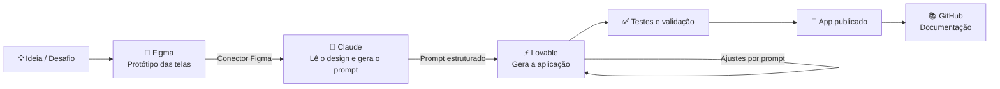
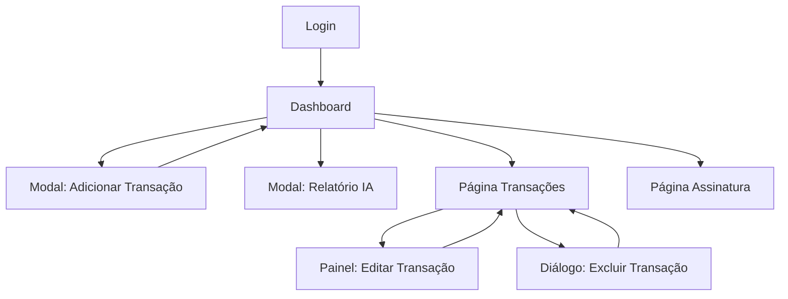
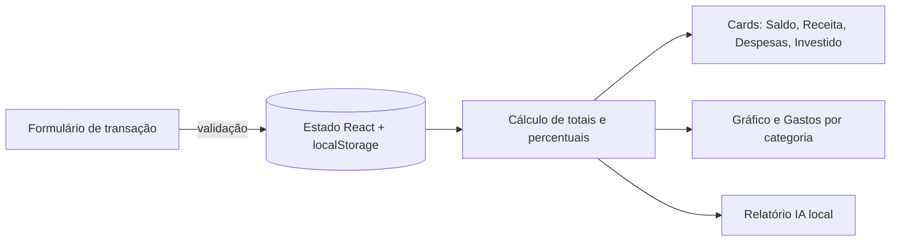

# 💰 MVC Finance

> Protótipo funcional de um app de controle financeiro pessoal, desenvolvido com **Figma** (design), **Claude** (IA para gerar o prompt) e **Lovable** (plataforma Low Code / Vibecode que transformou o design em aplicação usável).

Projeto da disciplina — **Aula 10: Projeto Low Code / No Code / Vibecode — Desenvolvimento e Automação com Suporte de Inteligência Artificial**.

🔗 **Acesse o protótipo:** `[cole aqui o link publicado do Lovable]`
🎨 **Protótipo no Figma:** [MVC Finance – Figma](https://www.figma.com/design/aBj3lo8u5tlRiYIwI14mRD/MVC-finance?node-id=57-1074)

---

## 📑 Sumário

1. [Descrição do desafio](#-1-descrição-do-desafio)
2. [Objetivos](#-2-objetivos)
3. [Equipe e divisão de papéis](#-3-equipe-e-divisão-de-papéis)
4. [Workflow de desenvolvimento](#-4-workflow-de-desenvolvimento)
5. [Plataformas escolhidas e justificativa](#-5-plataformas-escolhidas-e-justificativa)
6. [Integração Vibecode & IA](#-6-integração-vibecode--ia)
7. [Funcionalidades e telas](#-7-funcionalidades-e-telas)
8. [Arquitetura do fluxo](#-8-arquitetura-do-fluxo)
9. [Testes e validação](#-9-testes-e-validação)
10. [Evidências do protótipo](#-10-evidências-do-protótipo)
11. [Reflexão crítica](#-11-reflexão-crítica)
12. [Aprendizados e próximos passos](#-12-aprendizados-e-próximos-passos)

---

## 🎯 1. Descrição do desafio

Muitas pessoas não sabem para onde vai o próprio dinheiro: as entradas e saídas ficam espalhadas entre aplicativos de banco, cartões e anotações soltas, e no fim do mês é difícil responder perguntas simples como *"quanto eu gastei com moradia?"* ou *"sobrou dinheiro para investir?"*.

O **MVC Finance** resolve esse problema reunindo, em um único painel, o saldo, as receitas, as despesas e os investimentos do usuário, com gráficos e um relatório automático que resume o mês.

O escopo foi mantido **simples e bem definido**, como pede a proposta: um cadastro de transações com usuário fictício, sem integrações externas nem automações.

## 🧭 2. Objetivos

- Criar um protótipo **funcional e navegável** de controle financeiro pessoal.
- Permitir **cadastrar, editar e excluir** transações (depósitos, gastos e investimentos).
- Exibir indicadores do mês: **saldo, receita, despesas, valor investido** e **gastos por categoria**.
- Gerar um **relatório automático** com a análise do mês.
- Demonstrar na prática como **Figma + IA + Low Code** aceleram o caminho entre a ideia e um software usável.

## 👥 3. Equipe e divisão de papéis

| Integrante | Papel | Responsabilidades |
|---|---|---|
| `[Nome 1]` | Protótipo e Interface (UX/UI) | Criação das telas no Figma, identidade visual e fluxo de navegação |
| `[Nome 2]` | Integrações e IA (Vibecode) | Uso do Claude para ler o Figma e gerar o prompt; iterações de prompt no Lovable |
| `[Nome 3]` | Documentação e Apresentação | Testes do protótipo, registro no GitHub e preparação dos slides |

> A etapa de "Fluxos de Automação e Lógica" foi absorvida pelo papel de Integrações e IA, já que o projeto não utiliza automações externas — a lógica (cálculos, filtros e validações) foi definida no prompt e gerada pelo Lovable.

## 🛠 4. Workflow de desenvolvimento

Seguimos as etapas definidas na orientação do projeto:

```
[1. Definir o Desafio] ➔ [2. Escolher a Plataforma] ➔ [3. Integrar Vibecode / IA] ➔ [4. Testar e Validar] ➔ [5. Documentar]
```

| Etapa | O que fizemos | Ferramenta |
|---|---|---|
| **1. Definir o desafio** | Escolhemos o controle de finanças pessoais e listamos as funções essenciais | — |
| **2. Prototipar** | Desenhamos todas as telas e fluxos (login, dashboard, adicionar/editar/excluir transação, relatório IA, assinatura) | **Figma** |
| **3. Gerar o prompt com IA** | Conectamos o Figma ao Claude, que leu o protótipo e escreveu um prompt detalhado descrevendo telas, cores, componentes, regras e dados fictícios | **Claude** |
| **4. Construir o app** | Colamos o prompt no Lovable, que gerou a aplicação; depois refinamos com prompts curtos de ajuste | **Lovable** |
| **5. Testar e validar** | Testamos cada fluxo, campos obrigatórios e cenários de erro | Lovable (preview) |
| **6. Documentar** | Registramos o processo neste repositório e preparamos os slides | GitHub |

## 🧩 5. Plataformas escolhidas e justificativa

### 🎨 Figma — Design e prototipação
- Permite desenhar telas com precisão e montar o **fluxo de navegação** antes de qualquer código.
- Facilita o trabalho em grupo, já que todos editam o mesmo arquivo em tempo real.
- Por ter um **conector com o Claude**, o design pôde ser lido diretamente pela IA, sem precisar descrever tela por tela manualmente.

### 🤖 Claude — Inteligência Artificial (Vibecode)
- Funcionou como uma "ponte" entre o design e a plataforma de construção: leu a estrutura do Figma (textos, componentes, cores, valores) e **traduziu o protótipo em um prompt técnico** para o Lovable.
- Sugeriu decisões técnicas adequadas ao escopo, como usar **dados fictícios no `localStorage`** em vez de banco de dados e gerar o **Relatório IA localmente**, sem depender de API externa.

### ⚡ Lovable — Construção da aplicação (Low Code / Vibecode)
- Gera uma aplicação web completa (**React + TypeScript + Tailwind + shadcn/ui**) a partir de linguagem natural.
- Oferece **preview imediato** e publicação com um clique, o que agilizou testes e a entrega do link.
- Permite iterar por conversa ("mude a cor do botão", "adicione validação no campo valor"), ideal para quem não tem experiência avançada em programação.
- Em comparação com Bubble ou Adalo, o Lovable gera **código real e exportável** para o GitHub, o que torna o projeto mais fácil de evoluir depois.

## 🧠 6. Integração Vibecode & IA

O diferencial do projeto foi o **diálogo iterativo com IA** em duas camadas:

1. **Figma → Claude:** com o conector do Figma ativado, o Claude acessou o arquivo do protótipo, identificou as telas e os componentes (cards de saldo, lista de transações, formulário, gráfico de rosca, gastos por categoria) e entendeu o problema que o app resolve.
2. **Claude → Lovable:** o Claude produziu um prompt estruturado com:
   - identidade visual (cores em hexadecimal, fonte, bordas, ícones);
   - descrição de cada página e modal;
   - regras de negócio (totais e gráficos **calculados automaticamente** a partir das transações);
   - validações de formulário (campos obrigatórios, valor maior que zero);
   - dados iniciais fictícios e requisitos técnicos.
3. **Iterações no Lovable:** após a primeira geração, fizemos ajustes com prompts curtos e específicos, um de cada vez.

> 💡 **Sobre o "Relatório IA":** o botão existe no protótipo do Figma, mas como o projeto não tem integrações externas, o relatório é gerado **localmente** a partir dos dados do mês (total de receitas e despesas, maior categoria de gasto, saldo final e uma dica de economia). Ele simula o comportamento de uma IA sem consumir nenhuma API.

📄 O prompt completo utilizado está em [`docs/prompt-lovable.md`](docs/prompt-lovable.md). <!-- crie esse arquivo colando o prompt gerado -->

## 📱 7. Funcionalidades e telas

| Tela | Funcionalidades |
|---|---|
| **Login** | Tela de boas-vindas e entrada com usuário fictício (sem senha) |
| **Dashboard** | Saldo com opção de ocultar valor, cards de Investido / Receita / Despesas, gráfico de rosca (ganhos × gastos × investimentos), gastos por categoria, últimas transações e filtro por mês |
| **Adicionar Transação** | Modal com Título, Valor, Tipo (Depósito, Gasto, Investimento), Categoria, Método de pagamento e Data, com validação |
| **Transações** | Tabela completa com edição em painel lateral e exclusão com confirmação |
| **Relatório IA** | Modal com análise automática do mês |
| **Assinatura** | Comparativo entre Plano Básico (R$ 0/mês) e Plano Pro (R$ 19/mês), com ativação simulada |

## 🏗 8. Arquitetura do fluxo

### Processo de desenvolvimento



### Navegação do usuário



### Dados da aplicação



**Tecnologias geradas pelo Lovable:** React, TypeScript, Tailwind CSS, shadcn/ui, Recharts, React Router e lucide-react.

## 🧪 9. Testes e validação

Seguindo a orientação de **nunca aceitar lógicas geradas por IA sem testar**, validamos manualmente cada fluxo:

| # | Cenário testado | Resultado esperado | Status |
|---|---|---|---|
| 1 | Login com usuário fictício | Redireciona para o Dashboard | ✅ |
| 2 | Adicionar depósito válido | Transação aparece na lista; saldo e receita aumentam | ✅ |
| 3 | Adicionar gasto com categoria | Despesas e "Gastos por categoria" são atualizados | ✅ |
| 4 | Enviar formulário com campos vazios | Mensagens de erro em vermelho; nada é salvo | ✅ |
| 5 | Informar valor zero ou negativo | Erro de validação no campo Valor | ✅ |
| 6 | Editar uma transação | Dados atualizados e toast de sucesso | ✅ |
| 7 | Excluir uma transação | Diálogo de confirmação; após confirmar, item removido | ✅ |
| 8 | Trocar o mês no filtro | Cards, gráfico e lista mostram apenas o mês escolhido | ✅ |
| 9 | Recarregar a página | Transações continuam salvas (localStorage) | ✅ |
| 10 | Abrir o Relatório IA | Texto reflete os dados reais do mês | ✅ |
| 11 | Ocultar saldo (ícone de olho) | Valor substituído por "R$ ••••" | ✅ |
| 12 | Acessar pelo celular | Layout se adapta em uma coluna | ✅ |

> ✏️ Ajuste a coluna *Status* conforme os testes reais do grupo e registre aqui qualquer erro encontrado e como foi corrigido.

## 🖼 10. Evidências do protótipo

- **App publicado (Lovable):** `[link]`
- **Protótipo (Figma):** [link do arquivo](https://www.figma.com/design/aBj3lo8u5tlRiYIwI14mRD/MVC-finance?node-id=57-1074)

### Figma × Lovable

| Tela | Figma | Lovable |
|---|---|---|
| Login |  |  |
| Dashboard |  |  |
| Adicionar Transação |  |  |
| Transações / Editar |  |  |
| Excluir |  |  |
| Relatório IA |  |  |
| Assinatura |  |  |

> 📂 Salve os prints na pasta `docs/prints/` com esses nomes para que as imagens apareçam automaticamente.

## 🔍 11. Reflexão crítica

### ✅ Vantagens

1. **Velocidade do design ao produto.** O caminho Figma → Claude → Lovable levou uma ideia desenhada a um app navegável e publicado em poucas horas, algo que levaria semanas com programação tradicional.
2. **Menos trabalho manual de tradução.** Com o conector do Figma, o Claude leu o protótipo direto da fonte e descreveu telas, cores e regras com precisão, evitando que o grupo tivesse que redigir especificações longas à mão.
3. **Acessibilidade e código real.** Integrantes sem experiência avançada em programação conseguiram participar e iterar por linguagem natural, e o Lovable entrega código React exportável, que pode ser estudado e evoluído depois.

### ⚠️ Limitações

1. **Fidelidade parcial ao design.** A IA nem sempre reproduz o Figma pixel a pixel: espaçamentos, ícones e alguns textos precisaram de ajustes manuais por novos prompts. Além disso, o Claude conseguiu ler com detalhe apenas parte das telas e completou alguns textos (como benefícios dos planos) por inferência, o que exigiu revisão do grupo.
2. **Necessidade de validação constante.** O código gerado pode conter erros de lógica (cálculos, filtros, validações). Foi preciso testar cada fluxo, pois a IA "parece certa" mesmo quando não está — reforçando a orientação de nunca aceitar lógicas sem verificar.
3. **Dependência das plataformas e escopo simulado.** O projeto depende de créditos e planos do Lovable e do Claude, e funcionalidades como login, assinatura e o Relatório IA são **simuladas** (sem backend, autenticação real ou IA de verdade). Para virar um produto real, seria necessário integrar banco de dados, autenticação e uma API de IA, aumentando a complexidade.

## 🚀 12. Aprendizados e próximos passos

### Aprendizados
- Um **protótipo bem feito no Figma** é o que mais melhora o resultado da IA: quanto mais claro o design, mais fiel o app gerado.
- **Prompts grandes funcionam para a primeira versão**; para ajustes, prompts curtos e específicos dão resultados melhores.
- IA acelera o desenvolvimento, mas **não substitui o teste e o senso crítico** do time.

### Próximos passos
- [ ] Integrar banco de dados e autenticação real (ex.: Supabase, nativo do Lovable).
- [ ] Conectar o Relatório IA a uma API de IA real para análises personalizadas.
- [ ] Criar categorias personalizadas e metas de gastos.
- [ ] Exportar transações em PDF ou planilha.
- [ ] Desenvolver a página "Plataforma de Ensino" com conteúdos de educação financeira.

---

## 💻 Como acessar

O código da aplicação está hospedado no **Lovable**. Para usar o protótipo, basta abrir o link abaixo no navegador (computador ou celular) e clicar em **"Fazer login"**, já que o acesso é feito com um usuário fictício:

🔗 `[cole aqui o link publicado do Lovable]`

📄 A documentação completa em PDF está em [`docs/MVC_Finance_Documentacao.pdf`](docs/MVC_Finance_Documentacao.pdf).

---

<p align="center">Projeto acadêmico desenvolvido com Figma, Claude e Lovable 💙</p>
